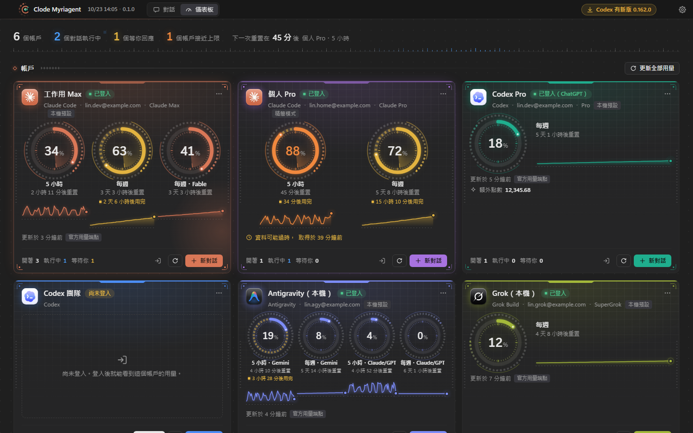
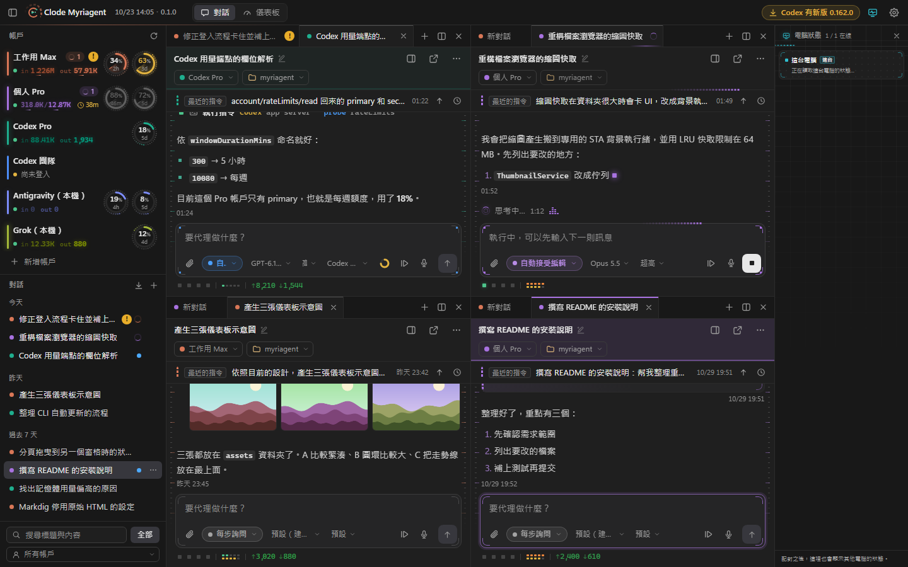

# Clode Myriagent

**一個桌面，指揮你所有的 AI 寫程式代理。**

Clode Myriagent 是 Windows 桌面程式（WinForms .NET 10＋WebView2）。它把 Claude Code、Codex、Grok Build 與 Antigravity 這幾種 AI 代理 CLI 放進同一個 VS Code 風格的對話介面。你可以同時登入多個訂閱帳戶，即時看到每個帳戶的用量；某個帳戶的額度用完時，工作會自動交給另一個帳戶接手。代理就是你電腦上的官方 CLI，用的是各帳戶的訂閱額度，不另外計算 API 費用。

搭配自己架設的 **MyriagentHub** 伺服器，可以讓多台電腦同步帳戶、用量與對話，也可以用手機或瀏覽器遠端操作任何一台電腦上的代理。

> 名稱取自「日理萬機」：同一個人、同一個畫面，指揮成千上萬件同時在跑的工作。



## 功能特色

**多家代理、多個帳戶**
- 支援 Claude Code（`claude`）、Codex（`codex`）、Grok Build（`grok`）與 Antigravity（`agy`），裝其中幾種都可以，沒裝的可以在 app 內安裝。
- 同一種代理可以登入多個訂閱帳戶，每個帳戶的設定資料夾各自隔離、互不干擾；這台電腦原本登入的帳戶會自動加入。
- 儀表板以圓環與 7 天走勢顯示每個帳戶的 5 小時、每週等額度窗、重置倒數與當日 token 用量。
- CLI 管理：偵測版本與新版、一鍵或自動更新；CLI 換版後，執行中的對話會在安全點以新版重開並自動接續。

**工作不中斷**
- 額度用完時，自動換到同一種代理的另一個帳戶接著做；也可以設定成換到別種代理。
- 沒有其他帳戶可換時，會等原帳戶的額度重置後自動接著做；原帳戶恢復後會自動換回來。
- 遇到 API 過載或網路瞬斷，會自動重試。
- app 換版、當機或重開機之後，做到一半的那一輪會自動接續；排隊中的訊息也會保留。

**VS Code 風格的對話**
- 多窗格（最多 4 欄 × 3 排）、多分頁、多視窗；分頁可以拖曳，也可以跨視窗拖曳。關掉分頁，對話照樣在背景執行。
- 精簡的工具卡、紅綠逐行差異、待辦清單、思考過程、問卷、工具核准、規劃模式的計畫確認、`@` 檔案、`/` 指令選單。
- 權限模式（Shift+Tab 切換）、模型與推理強度；執行中插入訊息、排隊、回溯、延伸成新對話。
- 附加圖片、影片與文件，貼上截圖、拖放；對話內有圖片燈箱、影片播放與檔案瀏覽器。
- 匯入你在終端機或 IDE 用 CLI 開過的歷史對話，接著繼續做。

**多電腦與遠端（需要自架 MyriagentHub）**
- 多台電腦同步帳戶目錄、用量與對話；手機或瀏覽器打開網頁版就能看所有電腦的對話、送訊息、核准、停止、上傳附件。
- 能不能被遠端操作，由每台電腦自己決定：不接受、只能查看或可以操作。
- 對話裡的代理可以用 `myriagent-remote` 在其他配對的電腦執行主控台指令。被操作的那台要先在本機開啟這個功能，高風險指令還要那台的人在現場同意。
- 協作人：建立帳號密碼，把指定的對話分享給別人一起用。
- app 自我更新：用你自己的金鑰簽章發佈新版，所有電腦會自動更新（見 [docs/release.md](docs/release.md)）。

**其他**
- 排程頁：管理代理替你建立的 Windows 排程，失敗時通知並自動請代理診斷；也能設定定時訊息，代理在對話裡可以用 `myriagent-schedule` 自己建立。
- 語音通知：完成、提問、需要核准時念一句說明。語音訊息：錄音後以本機的 faster-whisper 轉成逐字稿交給代理。
- 工作資料夾的 git 狀態；執行列可以一鍵建置並執行 .NET 視窗程式或 Electron 專案；監看對話開出的背景程式。
- 健康度檢查：全域指示、記憶、skill、MCP 太大時提醒，並可以請代理精簡。



（截圖是介面探針以模擬資料產生的）

## 架構

```
 ┌───────────────┐      HTTPS 443（Let's Encrypt）      ┌──────────────────┐
 │ 桌面 app（A）  │ ◀──────────────────────────────────▶ │                  │
 ├───────────────┤                                      │  MyriagentHub    │ ◀── 手機／瀏覽器
 │ 桌面 app（B）  │ ◀──────────────────────────────────▶ │（你自架的伺服器）│     （網頁版 /app/）
 └───────────────┘                                      └──────────────────┘
   每台電腦各自執行 CLI、各自保存登入憑證                   只保存與轉送同步資料，
                                                          不保存、不轉送任何 AI 帳戶的權杖
```

- **桌面 app** 不需要 Hub 也能完整使用。只在你配對之後，才會載入同步元件並連線。
- **MyriagentHub** 是 ASP.NET Core 的 Windows 服務（Kestrel 直接聽 443）。它內建 ACME，會自動申請與續期 Let's Encrypt 憑證，資料庫是 SQLite，每天自動備份。
- Claude、Codex 等 AI 帳戶的憑證永遠不離開它所在的電腦。伺服器收到的是帳戶清單、用量數字與對話內容；上傳之前，桌面會先遮蔽常見格式的權杖與金鑰。

## 系統需求

| 項目 | 桌面 app | MyriagentHub |
|---|---|---|
| 作業系統 | Windows 10 22H2／Windows 11（x64） | Windows 10／11 或 Windows Server 2019 以上（x64），長時間開機 |
| 執行環境 | .NET 10 Desktop Runtime、WebView2 Runtime（Windows 11 內建） | 自含式發佈，不需另外安裝 |
| 建置 | .NET 10 SDK、git | .NET 10 SDK、git |
| 其他 | 至少一種代理 CLI 與它的訂閱帳戶 | 一個網域名稱、從網際網路連得到的 TCP 443 |

## 快速開始

```powershell
git clone https://github.com/clodeku/myriagent.git
cd myriagent
dotnet build Myriagent.slnx -c Release
dotnet run --project src/Myriagent -c Release
```

第一次開啟後：

1. 在「儀表板」確認自動加入的帳戶。要新增帳戶，按「新增帳戶」登入 Claude Code、Codex、Grok 或 Antigravity。還沒安裝 CLI 的話，可以到「設定 → CLI」安裝。
2. 按「新對話」，選帳戶與工作資料夾，開始對話。
3. 想要固定安裝、開機自動啟動、自動更新：在「設定 → 版本與更新」選「安裝到這台電腦」。

完整步驟見 **[安裝文件](docs/install.md)**；要讓多台電腦同步、用手機操作，見 **[架設 MyriagentHub](docs/hub-setup.md)**。

## 文件

| 文件 | 內容 |
|---|---|
| [docs/install.md](docs/install.md) | 桌面 app 的安裝、更新、資料位置與移除 |
| [docs/usage.md](docs/usage.md) | 使用說明：帳戶、對話、儀表板、排程、同步、遠端操作與設定 |
| [docs/hub-setup.md](docs/hub-setup.md) | 架設 MyriagentHub：網域與憑證、安裝、更新、配對、備份、還原、疑難排解 |
| [docs/release.md](docs/release.md) | 用自己的金鑰簽章並發佈桌面版，讓所有電腦自動更新 |
| [docs/development.md](docs/development.md) | 開發：專案結構、建置與測試、程式風格 |
| [docs/web-protocol.md](docs/web-protocol.md) | 網頁 ↔ 桌面宿主的訊息協定 |
| [docs/sync-protocol.md](docs/sync-protocol.md) | 桌面 ↔ MyriagentHub 的同步協定 |
| [src/MyriagentHub/README.md](src/MyriagentHub/README.md) | 伺服器的資料夾、設定鍵、端點與管理指令（技術參考） |

## 專案結構

```
src/Myriagent             桌面 app（WinForms＋WebView2；網頁介面在 Web/）
src/Myriagent.Protocol    桌面與伺服器共用的模型、規則與協定 DTO
src/MyriagentHub          同步伺服器（ASP.NET Core Windows 服務）
src/MyriagentRemote       myriagent-remote：代理在其他電腦執行指令的命令列工具
src/MyriagentSchedule     myriagent-schedule：代理建立定時訊息的命令列工具
tests/                    單元與整合測試（xUnit）
tools/hub                 Hub 主機的安裝與更新腳本
tools/deploy              Hub 發佈套件的打包與安裝（健康閘門、自動回滾）
tools/release、release-tool  桌面版的打包、簽章與送件
tools/ui-probe、hub-e2e…   介面探針與端到端測試
```

## 授權

本專案以 **[PolyForm Noncommercial License 1.0.0](LICENSE)** 授權：個人、研究、教育與非營利組織可以免費使用、修改與散布，**不允許商業用途**。需要商業授權請寫信到 clodeku@gmail.com，或在 GitHub 開 issue。

Required Notice: Copyright (c) 2026 Clode Ku (https://github.com/clodeku/myriagent)

## 免責聲明

Clode Myriagent 是獨立的第三方工具，與 Anthropic、OpenAI、xAI、Google 沒有任何關聯，也沒有獲得它們的背書。本工具啟動並操作你電腦上已安裝的官方 CLI，使用的是你自己的訂閱帳戶；請自行遵守各家服務的使用條款。Claude、Codex、Grok、Antigravity 等名稱與商標屬於各自的所有人。

本軟體依「現狀」提供，不附任何擔保。AI 代理可能執行指令、修改或刪除檔案；請只在你信任的工作資料夾使用「完全自動」等權限模式，並定期備份。
